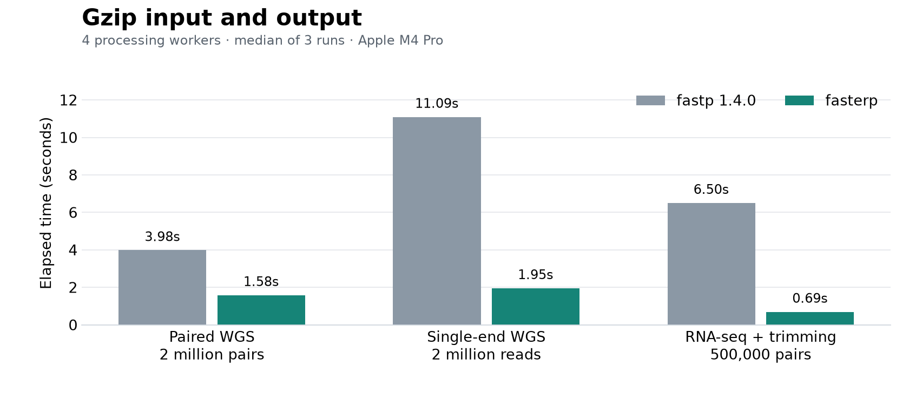

# Benchmarks

fasterp was faster than fastp 1.4.0 in **32 of 33 tested cases** on an Apple M4 Pro. The largest measured speedup was **9.42x**. One plain-file case was slower.

## Full results

Seconds, median of three runs. Speedup is fastp time divided by fasterp time; values above 1 favor fasterp.

| Workload | Workers | fastp (s) | fasterp (s) | Speedup |
|---|---:|---:|---:|---:|
| Single-end stdin to file | 1 | 0.52 | 0.25 | 2.08x |
| Single-end stdin to file | 4 | 0.23 | 0.17 | 1.35x |
| Single-end stdin to file | 8 | 0.23 | 0.12 | 1.92x |
| Single-end stdin to stdout | 1 | 0.52 | 0.25 | 2.08x |
| Single-end stdin to stdout | 4 | 0.23 | 0.13 | 1.77x |
| Single-end stdin to stdout | 8 | 0.20 | 0.13 | 1.54x |
| Paired files to stdout | 1 | 1.40 | 0.54 | 2.59x |
| Paired files to stdout | 4 | 0.46 | 0.17 | 2.71x |
| Paired files to stdout | 8 | 0.32 | 0.12 | 2.67x |
| Paired gzip files to stdout | 1 | 1.45 | 0.56 | 2.59x |
| Paired gzip files to stdout | 4 | 0.64 | 0.27 | 2.37x |
| Paired gzip files to stdout | 8 | 0.67 | 0.27 | 2.48x |
| Interleaved stdin to stdout | 1 | 1.38 | 0.66 | 2.09x |
| Interleaved stdin to stdout | 4 | 0.43 | 0.27 | 1.59x |
| Interleaved stdin to stdout | 8 | 0.35 | 0.23 | 1.52x |
| Merge with unmerged reads to stdout | 1 | 1.55 | 0.77 | 2.01x |
| Merge with unmerged reads to stdout | 4 | 0.52 | 0.24 | 2.17x |
| Merge with unmerged reads to stdout | 8 | 0.33 | 0.14 | 2.36x |
| 2 million WGS pairs, plain files | 1 | 5.44 | 2.21 | 2.46x |
| 2 million WGS pairs, plain files | 4 | 1.69 | 1.31 | 1.29x |
| 2 million WGS pairs, plain files | 8 | 1.04 | 1.47 | 0.71x |
| 2 million WGS pairs, gzip input | 1 | 5.45 | 2.39 | 2.28x |
| 2 million WGS pairs, gzip input | 4 | 2.23 | 1.18 | 1.89x |
| 2 million WGS pairs, gzip input | 8 | 2.27 | 1.08 | 2.10x |
| 2 million WGS pairs, gzip input/output | 1 | 5.48 | 2.27 | 2.41x |
| 2 million WGS pairs, gzip input/output | 4 | 3.98 | 1.58 | 2.52x |
| 2 million WGS pairs, gzip input/output | 8 | 2.45 | 1.47 | 1.67x |
| 2 million single-end WGS reads, gzip input/output | 1 | 13.65 | 1.97 | 6.93x |
| 2 million single-end WGS reads, gzip input/output | 4 | 11.09 | 1.95 | 5.69x |
| 2 million single-end WGS reads, gzip input/output | 8 | 11.12 | 1.96 | 5.67x |
| RNA-seq, gzip + detection/quality/poly-X trimming | 1 | 9.60 | 1.63 | 5.89x |
| RNA-seq, gzip + detection/quality/poly-X trimming | 4 | 6.50 | 0.69 | 9.42x |
| RNA-seq, gzip + detection/quality/poly-X trimming | 8 | 5.79 | 0.65 | 8.91x |

## Method

Measured October 17, 2026: Apple M4 Pro, 14 cores, 24 GiB RAM, macOS 26.3.1(a). Rust release build with native CPU tuning; fastp 1.4.0 built with clang 17, ISA-L 2.32.1, libdeflate 1.26 and Highway 1.4.0.

Inputs are unchanged prefixes of human WGS [SRR1766443](https://www.ebi.ac.uk/ena/browser/view/SRR1766443) and tomato RNA-seq [SRR13493714](https://www.ebi.ac.uk/ena/browser/view/SRR13493714). Stream cases use 500,000 records per mate, WGS file cases use two million, and RNA-seq uses 500,000 pairs. RNA-seq enables adapter detection, quality cutting and poly-X trimming.

Runs are serial with warm input caches. Stream tests use file redirection. Worker counts refer to processing workers; I/O and compression use additional threads. `/usr/bin/time -lp` records elapsed time, CPU time and peak RSS. Gzip levels are backend-specific; output sizes are recorded too.

Ordered decompressed FASTQ and checked report values matched on the first repetition of every case. [Compatibility notes](COMPATIBILITY.md) explain report differences. Plain-file timings varied substantially; all runs, including the slower result, are retained. These results describe the tested machine and inputs.

[Raw measurements, build hashes and output checks](benchmarks/macos-arm64.json) · [Reproduce the benchmark](benchmarks/REPRODUCE.md)
